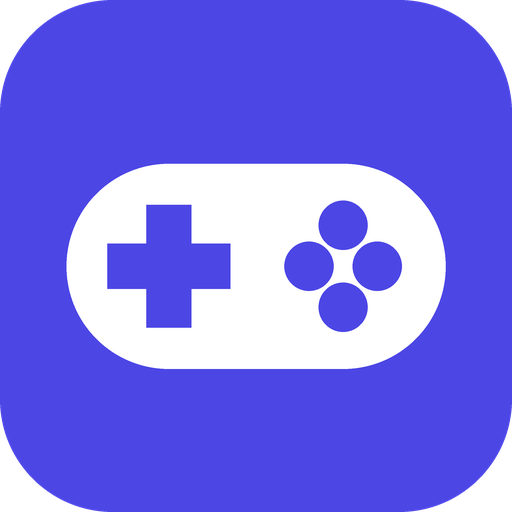

<p align="center">
  
</p>

<h1 align="center">Console Mode</h1>

<p align="center">
  Cambia tu PC con Windows entre <b>modo PC</b> y <b>modo consola</b> con un toque desde el móvil.
</p>

---

Al pasar a **modo consola**, Console Mode pone la TV como pantalla principal, cambia el audio a la salida que
elijas y abre **Steam Big Picture** (o **Playnite**, u otro frontal que elijas) en esa pantalla. Al volver a
**modo PC** lo cierra y deja tu monitor y tu audio de siempre.

Tiene dos partes:

| | |
|---|---|
| **App de PC** (`pc/`) | App de Windows (C# / .NET 8) muy sencilla. Arranca en segundo plano, con o sin icono en la bandeja, y sirve para vincular móviles, elegir la pantalla y el audio de cada modo y cambiar de modo. |
| **App móvil** (`mobile/`) | App Flutter (Android / iOS). Encuentra el PC con un QR o buscando en la red, lo guarda y muestra un interruptor PC / Consola. |

## Funciones

- **Interruptor PC / Consola** en el móvil, en la ventana del PC y en el menú del icono de la bandeja.
- **Por cada modo**: pantalla principal, salida de audio, micrófono y salida de comunicaciones (la que usan Discord,
  Teams o Zoom), o «No cambiar» en cada una.
- **Frontal del modo consola**: **Steam Big Picture**, **Playnite** en pantalla completa u **otro programa** (LaunchBox
  Big Box, EmulationStation, un launcher propio...). Se abre al entrar en modo consola, se coloca a la fuerza en la
  pantalla de la consola y se cierra al volver a modo PC (cada cosa se puede desactivar). Con Playnite tienes también
  los juegos de Epic, GOG, EA, Ubisoft o los emuladores de RetroArch.
- **Vincular móviles** con código QR o buscando en la red local (broadcast UDP).
- **Dispositivos de confianza**: la primera vez el PC pregunta «¿Confiar en este dispositivo?». Después no vuelve a
  preguntar. Puedes quitar dispositivos cuando quieras.
- **Segundo plano**: al cerrar la ventana la app sigue funcionando. El icono de la bandeja (en «iconos ocultos»)
  es opcional.
- **Iniciar con Windows** (opcional), directamente en segundo plano.
- **Overlay con el mando**: mantén **View + Menú** durante 1 segundo en un mando Xbox para cambiar de modo, de audio,
  de micrófono o de pantalla, subir o bajar el volumen y silenciar el sonido o el micrófono desde el sofá (ver más
  abajo).
- **Botón de encendido en el móvil**: enciende el PC con Wake-on-LAN y lo pone en el modo que elijas, o lo suspende o
  apaga. Console Mode prepara Windows por ti (y lo deja como estaba si lo desactivas). Ver
  [Encender el PC a distancia](#encender-el-pc-a-distancia).
- **Cambio rápido desde el móvil**: debajo del interruptor puedes elegir la salida de audio, el micrófono, la salida de
  comunicaciones y la pantalla principal del PC al momento, sin cambiar la configuración de tus modos.
- **Actualizaciones desde la app**, tanto en el PC como en Android.
- Si el PC cambia de IP, el móvil lo vuelve a encontrar solo.
- **Instalador** o **versión portable**, a tu elección.

## ¿Se puede forzar Big Picture en la pantalla de la TV?

Sí. Se hace en dos pasos:

1. Antes de abrir Big Picture, Console Mode convierte la TV en **pantalla principal**. Steam abre Big Picture en la
   pantalla principal, así que normalmente ya aparece ahí.
2. Si Steam la abre en otra pantalla (a veces recuerda la última posición), Console Mode busca la ventana de
   Big Picture durante 60 segundos y la **mueve y la ajusta** al tamaño de la pantalla de la consola. Esto es la
   opción «Forzar Big Picture en la pantalla del modo consola».

## Instalación

Descarga los archivos desde [Releases](https://github.com/katarem/console-mode/releases):

| Archivo | Para qué |
|---|---|
| `ConsoleMode-Setup-X.Y.Z.exe` | **Instalador** para Windows (recomendado). |
| `ConsoleMode-X.Y.Z-portable.exe` | **Versión portable** para Windows: un solo `.exe`, sin instalación. |
| `ConsoleMode-X.Y.Z.apk` | App para Android. |

Las dos versiones de Windows usan la misma configuración (`%APPDATA%\ConsoleMode`), así que puedes pasar de una a otra
sin volver a configurar nada. No necesitan tener .NET instalado.

Como los ejecutables no están firmados, Windows SmartScreen puede avisar: pulsa «Más información» → «Ejecutar de
todas formas».

### PC con instalador (Windows 10 / 11)

Ejecuta `ConsoleMode-Setup-X.Y.Z.exe`. El instalador:

- instala Console Mode en `Archivos de programa` y crea un acceso directo en el menú Inicio (y en el escritorio, si
  lo eliges);
- crea la regla del **firewall de Windows** para redes privadas, así que no hace falta configurar nada más;
- puede dejar activado **Iniciar con Windows**. Luego lo puedes cambiar desde *Ajustes* en la app;
- en una actualización, cierra la versión en marcha, la sustituye y conserva la configuración.

Para desinstalarlo, ve a *Configuración → Aplicaciones*. Al desinstalar se borran la regla del firewall y el inicio
automático, pero se conserva la configuración.

### PC portable

1. Copia `ConsoleMode-X.Y.Z-portable.exe` a una carpeta fija, por ejemplo `C:\Programas\ConsoleMode\`, y ábrelo.
2. Cuando el **firewall de Windows** pregunte, permite el acceso en **redes privadas**. Si no aparece el aviso, o lo
   cerraste, ejecuta esto en una consola como administrador:

   ```powershell
   netsh advfirewall firewall add rule name="Console Mode" dir=in action=allow program="C:\Programas\ConsoleMode\ConsoleMode-X.Y.Z-portable.exe" enable=yes profile=private
   ```

Con cualquiera de las dos versiones, comprueba que tu Wi-Fi o Ethernet esté como **red privada** y no como red
pública.

### Móvil

- **Android**: instala `ConsoleMode.apk` (activa «instalar apps de origen desconocido»).
- **iOS**: compílalo tú con Xcode (`cd mobile && flutter run --release`). En iOS, la búsqueda en la red necesita
  el permiso especial de Apple `com.apple.developer.networking.multicast`. Sin él, usa el **código QR**.

## Uso

1. **Configura los modos**, en la pestaña *Modos* de la app de PC:
   - Modo PC: tu monitor como pantalla principal y tus auriculares o altavoces.
   - Modo Consola: la TV como pantalla principal y la salida de audio de la TV o del receptor AV.
   - **Micrófono** y **Comunicaciones** (opcionales): por ejemplo, el juego por la TV y Discord por los auriculares
     con su micrófono. «Comunicaciones» es el «dispositivo de comunicaciones predeterminado» de Windows: Discord lo usa
     si eliges ese dispositivo en sus ajustes de voz. El micrófono se pone como predeterminado y también como el de
     comunicaciones.

   La TV tiene que estar **encendida y conectada** (como pantalla extendida) para que aparezca en la lista y para
   poder cambiar a ella.
2. **Vincula el móvil**: en la app móvil, pulsa «Escanear código QR» y apunta al QR de la pestaña *Móviles* del PC,
   o pulsa «Buscar en la red». Acepta la solicitud que aparece en el PC.
3. **Cambia de modo** con el interruptor del móvil, con los botones de la ventana del PC o con el menú del icono de
   la bandeja.

### Overlay con el mando

Con un mando **Xbox o compatible XInput** (incluidos los 8BitDo en modo X), mantén **View + Menú** (los dos botones
pequeños del centro) durante **1 segundo**. Aparece un panel en la esquina inferior derecha con:

- **Volver a modo PC** (en modo consola): cierra el frontal (Big Picture, Playnite...) y vuelve a tu pantalla y tu audio del modo PC, sin
  soltar el mando.
- **Ir a modo consola** (en modo PC): el panel se cierra y se activa el modo consola, con el frontal en la TV.
- **Cerrar juego** (si hay un juego delante al abrir el panel): **A** dos veces lo cierra como Alt+F4. Si no se cierra
  en unos segundos (hay juegos sin opción de salir que tampoco hacen caso), ofrece **forzar el cierre**. Después el
  foco vuelve al frontal. Útil con Playnite u otros frontales, que no tienen el menú de Big Picture para salir del juego.
- **Silenciar sonido** y **Silenciar micro**: dos botones, uno al lado del otro (elige con ← →). El micrófono se
  silencia también como dispositivo de comunicaciones, así que Discord tampoco te oye.
- **Salida de audio**, **Micrófono**, **Comunicaciones** y **Pantalla principal**: cada opción muestra solo lo elegido
  ahora. Al pulsar **A**, el panel pasa al centro de la pantalla con la lista de opciones. Elige con **A** o vuelve
  con **B**. Si el frontal está abierto y cambias de pantalla, se mueve a la elegida.
- **Volumen** del sonido y del micrófono: ajústalo con **← →** (de 5 en 5 %). **A** silencia o activa.

Usa la **cruceta o el stick** para moverte, **A** para elegir y **B** (o View + Menú otra vez) para cerrar. El panel
también se cierra solo tras 20 segundos sin usarlo.

Lo que elijas aquí es **temporal**: no cambia la configuración de tus modos. La próxima vez que cambies de modo se
aplicará lo que tengas configurado en la pestaña *Modos*.

Notas:

- Mientras el panel está abierto se queda con el foco, para que A y B no lleguen también a Big Picture o al juego. Al
  cerrarlo, el foco vuelve donde estaba. Al mantener View + Menú, el juego también recibe esas pulsaciones (por
  ejemplo, puede abrir su menú de pausa).
- No se ve encima de juegos en **pantalla completa exclusiva**. Con «ventana sin bordes» y en Big Picture sí.
- Se puede desactivar en *Modos → Modo Consola*. También se abre desde el menú del icono de la bandeja.

### Encender el PC a distancia

La pantalla de cada PC en el móvil tiene un **botón de encendido**:

- Mientras no hay conexión con el PC (apagado, en suspensión o aún conectando), lo **enciende**: envía un «paquete
  mágico» de Wake-on-LAN por la red local, espera a que Console Mode responda y lo pone en el modo elegido.
- Con el PC encendido, lo **suspende** o lo **apaga** (pide confirmación).

En el icono de ajustes (arriba a la derecha) eliges, para cada PC, **en qué modo se pone al encender** (Consola, PC o
sin cambiar) y si el botón **suspende o apaga**. Suspender es más rápido y el PC se vuelve a encender con más
fiabilidad. Ahí también está **Olvidar este PC**.

El paquete de Wake-on-LAN no puede llevar el modo: lo pide el móvil al conectar con el PC, aunque el PC diga que ya
está en ese modo (al arrancar recuerda el modo en el que se apagó, pero el frontal no está abierto). La petición se
guarda durante 15 minutos, así que funciona aunque la app pase a segundo plano o se cierre mientras Windows arranca, o
aunque tengas que iniciar sesión con el PIN: basta con volver a abrir la app.

Para que funcione:

1. **BIOS/UEFI**: activa Wake-on-LAN. Según el fabricante se llama «Wake on LAN», «Power On By PCI-E», «Resume by
   PCI-E Device» o «Remote Wake Up». Si existe «ErP» o «Deep Sleep», desactívalo.
2. **Cable**: conecta el PC por Ethernet. Por Wi-Fi casi nunca funciona desde apagado.
3. **Windows**: en la pestaña *Encendido* de la app de PC, marca lo que quieras y pulsa **Aplicar** (pide permiso de
   administrador una vez):
   - **Tarjeta de red**: activa «Activar con paquete mágico» y «Permitir que este dispositivo reactive el equipo», y
     desactiva el despertar por patrones (para que el tráfico normal de la red no lo despierte).
   - **Mando**: permite que el adaptador inalámbrico de Xbox y el Bluetooth despierten el PC. Solo funciona desde
     **suspensión**, y no en todos los equipos: pruébalo pulsando el botón Xbox con el PC suspendido.
   - **Inicio rápido**: lo desactiva, porque en muchos PCs impide encender desde apagado.
   - **No pedir el PIN al volver de la suspensión** (desmarcado por defecto). Al encender o reiniciar se sigue
     pidiendo.
4. **Móvil**: conéctate al PC una vez con la app nueva para que guarde los datos de su tarjeta de red.

Console Mode guarda cómo estaba cada ajuste en `%ProgramData%\ConsoleMode\wake-setup.json`. Con **Deshacer todo**, o al
desinstalar la app, todo vuelve a quedar como antes. La pestaña también tiene una guía, incluido cómo hacer que Windows
inicie sesión solo con sus propias herramientas (Console Mode no guarda tu contraseña).

### Actualizaciones

- **PC**: Console Mode busca versiones nuevas al arrancar y cada 12 horas (se puede desactivar en *Ajustes*). Si hay
  una, avisa en el icono de la bandeja y en *Ajustes → Actualizaciones* aparece **Actualizar ahora**:
  - **Versión instalada**: descarga el instalador nuevo y lo ejecuta en modo silencioso. Windows pide permiso de
    administrador, y al terminar la app se vuelve a abrir sola.
  - **Versión portable**: descarga el `.exe` nuevo, sustituye al actual (mismo nombre y carpeta) y se vuelve a abrir.
  - Antes de aplicar, se comprueba el SHA-256 del archivo descargado con el que publica GitHub.
- **Android**: al abrir la app se comprueba si hay un APK nuevo y aparece un aviso con **Actualizar**. También puedes
  buscarlo con el botón de actualización de la barra superior. Android descarga el APK y, al tocar la notificación,
  lo instala encima sin perder los PCs emparejados.

Cada app busca su propio archivo en las últimas releases (`ConsoleMode-Setup-X.Y.Z.exe`,
`ConsoleMode-X.Y.Z-portable.exe` o `ConsoleMode-X.Y.Z.apk`), así que una release no tiene por qué traer las dos.

### Segundo plano e inicio con Windows

En la pestaña *Ajustes*:

- **Mostrar icono en la bandeja del sistema**: si lo desactivas, la app sigue funcionando pero sin icono. Para volver
  a ver la ventana, ejecuta otra vez `ConsoleMode.exe`. No se abre una segunda copia: se muestra la ventana de la
  que ya está en marcha.
- **Iniciar con Windows**: crea la tarea programada «Console Mode (tu usuario)», que abre la app en segundo plano
  (`--background`) nada más iniciar sesión. Es más rápido que la carpeta de inicio o `HKCU\…\Run`, que Windows abre
  con retraso y uno detrás de otro, y así Console Mode está listo antes para cambiar de pantalla o atender al móvil.
  Los primeros minutos funciona con prioridad alta. No necesita permisos de administrador.
- **Salir de Console Mode**: cierra la app del todo (también está en el menú del icono).

La configuración se guarda en `%APPDATA%\ConsoleMode\settings.json` y el registro en `console-mode.log`, en la misma
carpeta.

## Cómo funciona

| Acción | Cómo |
|---|---|
| Pantalla principal | `QueryDisplayConfig` para identificar cada monitor de forma estable (nombre EDID y ruta del dispositivo) y `ChangeDisplaySettingsEx` con `CDS_SET_PRIMARY`, recolocando todos los monitores para que el nuevo principal quede en (0,0). |
| Audio predeterminado | Interfaz COM `IPolicyConfig` (la misma que usa el panel de Sonido de Windows), para los roles consola, multimedia y comunicaciones (la salida de comunicaciones del modo, si la hay, cambia solo ese rol después). Volumen y silencio con `IAudioEndpointVolume` (NAudio). El audio se cambia después de la pantalla y se reintenta unos segundos, porque la salida HDMI de una TV puede tardar en aparecer. |
| Abrir Big Picture | `steam://open/bigpicture` |
| Colocar Big Picture | Se busca la ventana de `steamwebhelper` cuyo título contiene «Big Picture» (Steam puede separar las palabras con un espacio de no separación, U+00A0) y se mueve con `SetWindowPos` al rectángulo de la pantalla elegida. |
| Cerrar Big Picture | `steam://close/bigpicture`. Si no responde, se envía `WM_CLOSE` a la ventana. |
| Otros frontales | Playnite se busca en su carpeta de instalación (`Playnite.FullscreenApp.exe`) o se elige a mano. Se abre el `.exe` (si ya está abierto, se pone delante), su ventana más grande se lleva a la pantalla de la consola igual que Big Picture y se cierra con `WM_CLOSE`. |
| Overlay del mando | Se lee XInput (`xinput1_4.dll`) en segundo plano a ~30 Hz, sin necesitar el foco. Los huecos de mando vacíos solo se consultan cada 2 s. |
| Encendido a distancia | El móvil envía el paquete mágico (6 × `0xFF` + la MAC 16 veces) por broadcast UDP a los puertos 9 y 7. Para preparar Windows, la app se relanza como administrador (`--wake-setup apply|revert`) y usa `Set-NetAdapterPowerManagement`, `MSPower_DeviceWakeEnable` (WMI), `HiberbootEnabled` y `powercfg` (CONSOLELOCK). |
| Red | TCP (JSON por líneas) en el puerto 47820 y descubrimiento UDP en el 47821. Ver [docs/PROTOCOL.md](docs/PROTOCOL.md). |

### Seguridad

- Solo funciona en tu red local. No hay servidores ni cuentas.
- Un móvil nuevo no puede hacer nada hasta que lo aceptas en el PC. Desde ese momento, el móvil demuestra que es él con
  un HMAC sobre un reto aleatorio, sin volver a enviar su clave.
- En el PC, las claves se guardan cifradas con DPAPI, ligadas a tu usuario de Windows.
- El tráfico no va cifrado (solo lleva órdenes de cambio de modo). No expongas el puerto a Internet.

## Compilar desde el código

```bash
# App de PC (necesita el SDK de .NET 8; se puede compilar desde Linux/macOS)
dotnet publish pc/ConsoleMode/ConsoleMode.csproj -c Release -r win-x64 --self-contained true \
  -p:PublishSingleFile=true -p:IncludeNativeLibrariesForSelfExtract=true -o publish

# App móvil (Flutter 3.35)
cd mobile
flutter pub get
flutter test
flutter build apk --release
```

Para generar el instalador hace falta [Inno Setup 6](https://jrsoftware.org/isinfo.php) (solo en Windows):

```powershell
iscc /DAppVersion=1.1.0 /DSourceExe=..\publish\ConsoleMode.exe installer\ConsoleMode.iss
```

La versión de cada app es independiente: `<Version>` en `pc/ConsoleMode/ConsoleMode.csproj` y `version:` en
`mobile/pubspec.yaml`. El nombre de cada archivo de la release lleva la versión de su app.

GitHub Actions tiene dos workflows:

- **`ci.yml`, en cada pull request**: comprobaciones rápidas de la app que haya cambiado (`dotnet build` para la de
  PC; `flutter analyze` y `flutter test` para la móvil). No genera instaladores ni APK. Un push nuevo cancela la
  comprobación anterior de la misma PR, y los cambios que solo tocan el README o `docs/` no lanzan nada.
- **`release.yml`, al fusionar en `main`**: la etiqueta es la versión más alta de las dos apps. Si esa etiqueta
  `vX.Y.Z` todavía no existe, compila (una sola vez) las apps que hayan cambiado desde la etiqueta anterior, crea la
  etiqueta y publica la release. Si ya existe, no compila nada. Para sacar una release, sube la versión de la app que
  cambie en el mismo PR. También se puede lanzar a mano con «Run workflow».

Si cambian los propios workflows, se compilan las dos apps.

### Firma del APK

Android solo instala una actualización encima de la app si está firmada con **la misma clave**. La CI firma el APK con
la clave guardada en estos secretos del repositorio (*Settings → Secrets and variables → Actions*):

| Secreto | Contenido |
|---|---|
| `ANDROID_KEYSTORE_BASE64` | El archivo `.jks` en Base64. |
| `ANDROID_KEYSTORE_PASSWORD` | Contraseña del almacén. |
| `ANDROID_KEY_ALIAS` | Alias de la clave (por ejemplo `upload`). |
| `ANDROID_KEY_PASSWORD` | Contraseña de la clave (opcional si es la misma que la del almacén). |

Para crearla una sola vez, con el `keytool` de Java o el de Android Studio (`jbr\bin\keytool.exe`):

```powershell
keytool -genkeypair -v -keystore upload-keystore.jks -keyalg RSA -keysize 2048 -validity 10000 -alias upload
[Convert]::ToBase64String([IO.File]::ReadAllBytes("upload-keystore.jks")) | Set-Clipboard   # pega esto en ANDROID_KEYSTORE_BASE64
```

Guarda una copia del `.jks` y de su contraseña fuera del repositorio: si se pierde, el siguiente APK no se podrá instalar
encima y habrá que desinstalar la app. Si faltan los secretos, la release se publica sin APK. Compilando en local sin
`android/key.properties`, se firma con la clave de depuración.

## Estructura

```
pc/ConsoleMode/
  Core/       Configuración, cambio de modo, inicio con Windows, encendido a distancia y log
  Native/     Pantallas, audio, frontales (Big Picture, Playnite...) y energía (Win32 / COM)
  Network/    Servidor TCP, emparejamiento y descubrimiento UDP
  UI/         Ventana principal, icono de bandeja y diálogo de emparejamiento
mobile/lib/
  services/   Protocolo, emparejamiento, conexión, descubrimiento y Wake-on-LAN
  screens/    Inicio, escáner QR, búsqueda, emparejamiento y control
  widgets/    Interruptor PC / Consola
installer/    Script del instalador (Inno Setup)
docs/         Protocolo
```

## Limitaciones conocidas

- La TV tiene que estar activa como pantalla extendida. Console Mode no enciende la TV ni cambia el modo de proyección
  (por ejemplo «Solo segunda pantalla»).
- El HDR, la resolución y la frecuencia de refresco no se cambian. Se mantienen los de cada pantalla.
- `IPolicyConfig` no está documentada oficialmente, aunque funciona en Windows 10 y 11 desde hace años.

## Licencia

[MIT](LICENSE)
